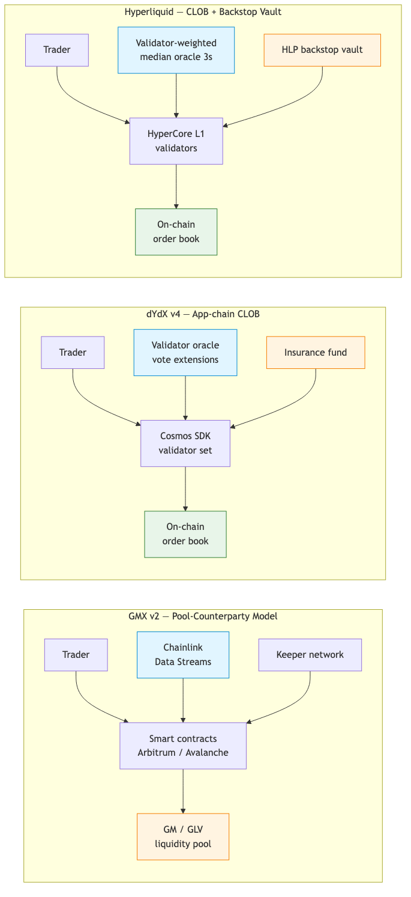
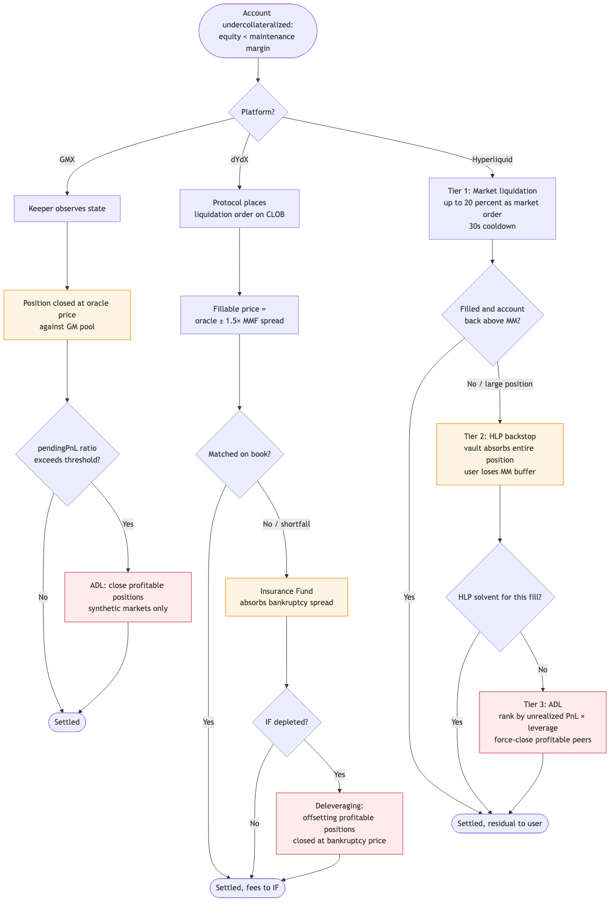
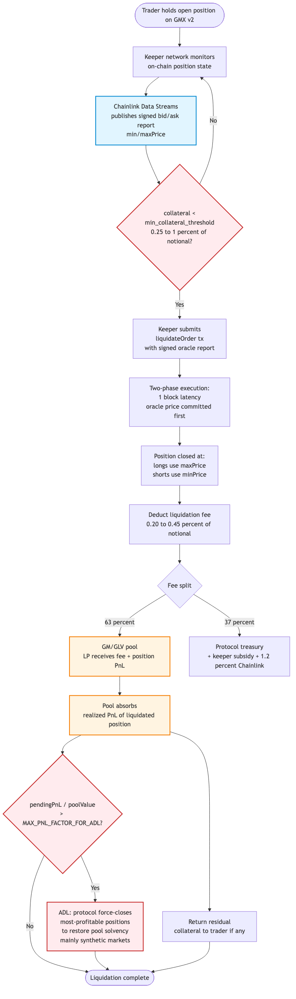

# 1. Abstract

Decentralized perpetual exchanges (perp DEXes) now process tens of billions of USD in daily notional volume. Their liquidation engine is the single most safety-critical component: it decides who pays for a losing trade, how fast bad debt is closed, and ultimately who absorbs losses when markets gap. This report compares three architecturally distinct platforms — **GMX** (pool-counterparty AMM-style perps), **dYdX v4** (validator-run on-chain CLOB), and **Hyperliquid** (HyperCore L1 CLOB with a protocol-owned backstop vault) — across leverage design, liquidation logic, oracle integrity, and extreme-volatility defenses. We then dive into GMX's liquidation flow, quantify the GM-pool LP impact with a worked example, and close with a risk taxonomy and forward-looking design directions illustrated by real incidents including the **Hyperliquid JELLY squeeze of March 2025**.

# 2. Background: Anatomy of a Perp Liquidation

A perpetual contract is a derivative with no expiry; it tracks an index price through a **funding rate** that periodically transfers value between longs and shorts. Each position posts **initial margin (IM)** as collateral; the position becomes liquidatable when account equity falls below **maintenance margin (MM)**.

Key concepts used throughout this report:

- **Mark price**: the price used for PnL and liquidation checks, distinct from the last trade price.
- **Liquidator / keeper**: the actor that submits the closing transaction in exchange for a reward.
- **Insurance fund (IF)**: pooled capital that absorbs shortfalls when the liquidation price is worse than bankruptcy.
- **Auto-deleveraging (ADL)**: a last-resort socialization mechanism that force-closes profitable positions to clear bad debt.

Designers face a fundamental three-way trade-off: **user experience** (high leverage, low fees, partial liquidations), **system safety** (conservative MM, large IF, fast oracles), and **decentralization** (permissionless keepers, no admin pause). The three platforms studied here sit at different points on this triangle.

# 3. Platform Architectures Side-by-Side

{ width=85% }

| Dimension       | GMX v2 `[GMX-OV]`                                              | dYdX v4 `[DYDX-PORT]`                                      | Hyperliquid `[HL-LIQ]`                                                |
| --------------- | -------------------------------------------------------------- | ---------------------------------------------------------- | --------------------------------------------------------------------- |
| Venue           | Arbitrum / Avalanche L2                                        | Cosmos SDK app-chain                                       | HyperCore L1 (custom BFT chain)                                       |
| Matching        | No order book — oracle-priced AMM-style fills against GM pool  | On-chain central limit order book (CLOB) run by validators | On-chain CLOB run by validators                                       |
| Counterparty    | GM / GLV liquidity pool (LPs)                                  | The other side of the book + insurance fund                | The other side of the book + HLP backstop vault                       |
| Custody         | Non-custodial smart contracts                                  | Funds held in chain modules                                | Funds held in HyperCore L1 state                                      |
| Settlement unit | USD-denominated; collateral in pool tokens (e.g. WETH + USDC) | USDC                                                       | USDC                                                                  |
| Liquidator role | Permissionless keeper bots                                     | Any full-node operator running the liquidation daemon      | Any market participant (market liq) + HLP vault (backstop)            |
| Oracle          | Chainlink Data Streams (signed pull-based) `[GMX-ORD]`         | Validator vote-extension aggregation `[DYDX-ORC]`          | Validator-weighted median of CEX spot prices, 3-second cadence `[HL-ORC]` |

The architectures encode three philosophies. GMX shifts counterparty risk onto a passive LP pool and accepts oracle dependence as the price of zero order-book infrastructure. dYdX rebuilds a CEX-style CLOB inside a sovereign chain, treating the validator set itself as the matching engine and price source. Hyperliquid blends both: a CLOB for normal flow, plus an HLP vault that acts as a community-funded market maker and insurance fund in one.

# 4. Leverage and Margin Design

| Item               | GMX `[GMX-LIQ]`                                                   | dYdX v4 `[DYDX-MGN]`                                         | Hyperliquid `[HL-TIER]`                                              |
| ------------------ | ----------------------------------------------------------------- | ------------------------------------------------------------ | -------------------------------------------------------------------- |
| Max leverage       | up to 100× crypto; 25–40× TradFi off-hours                       | 1–50× depending on market liquidity tier                     | 3–40× per asset (BTC 40× → 20× above \$150M OI; ETH 25× → 15×)    |
| Margin mode        | pool-collateralized; no formal cross/iso                          | cross (default) + isolated subaccounts                       | cross (default) + isolated; tiered MM table                          |
| Initial margin     | market-dependent floor                                            | $\text{IM} = |S \cdot P| \cdot \text{IMF}$, IMF 2–100 %       | $\text{IM} = \text{notional} / \text{leverage}$                      |
| Maint. margin      | 0.25–1 % of notional (asset floor)                                | fixed MMF per market                                         | $\text{MMR} = \text{IMR}/2$ at max lev.; widens by tier              |
| Liq. rule          | `collateral < min_threshold`                                      | `account_value < total_MMR`                                  | `equity < MM_required`                                               |

Hyperliquid's tiered structure is the most aggressive on UX (40× BTC is rare in DeFi) but the protocol claws safety back by reducing leverage as a single account's open interest grows — a structural defense against whale-driven cascades. dYdX's MMF is **fixed per market** and **scales with open interest caps**, providing predictable margin requirements at the cost of less granularity. GMX's "minimum collateral threshold" model is the simplest from a user mental-model perspective but couples liquidation tightly to oracle freshness.

# 5. Liquidation Logic Comparison

{ width=80% }

### 5.1 Trigger and executor

- **GMX `[GMX-LIQ]`** — A permissionless keeper network monitors on-chain position state. When `collateral < min_collateral_threshold` (0.25 %–1 % of notional, market-dependent), any keeper may submit a liquidation transaction carrying a signed Chainlink Data Streams report. Execution is two-phase: the oracle price is committed in block *N* and the position closes in block *N+1*, reducing keeper MEV opportunities `[GMX-ORD]`.
- **dYdX v4 `[DYDX-LIQ]`** — The chain itself detects accounts below MMR each block. A liquidation order is **automatically generated by the protocol** and placed on the open CLOB. Any node running the liquidation daemon competes to fill it.
- **Hyperliquid `[HL-LIQ]`** — A three-tier waterfall:
  1. **Market liquidation** — the first 20 % of the position is sent to the book as a market order, with a 30-second cooldown before the rest;
  2. **HLP backstop** — if fewer than two-thirds of required MM can be filled, the remaining position is transferred wholesale to the HLP vault;
  3. **ADL** — if HLP cannot absorb the loss, profitable counter-positions are force-closed at mark price.

### 5.2 Liquidation price and penalty

- **GMX**: closes at the worse side of the oracle spread (longs at `maxPrice`, shorts at `minPrice`). Liquidation fee is **0.20 %** for standard markets and **0.45 %** for synthetic / high-volatility markets, deducted from the position notional `[GMX-FEE]`.
- **dYdX**: closes at a *fillable price* $P_{\mathrm{fill}}$ derived from the oracle by widening the spread toward bankruptcy as the account deteriorates:
$$P_{\mathrm{fill}} \;=\; P \cdot \Bigl(\,1 \;-\; s \cdot \mathrm{SMMR} \cdot \mathrm{MMF} \cdot \mathrm{BA} \cdot (1 - Q)\,\Bigr)$$
  with the following variable convention `[DYDX-LIQ]`:

  - $s = +1$ when liquidating a **long** (sell side, fill below oracle) and $s = -1$ for a **short** (buy side, fill above oracle), guaranteeing the fill is always adverse to the liquidatee;
  - $\mathrm{SMMR}$ is the protocol-wide *Spread-to-Maintenance-Margin Ratio* (currently $1.0$–$1.5$), which caps how much of the maintenance band can be paid out as liquidation discount;
  - $\mathrm{MMF}$ is the per-market maintenance-margin fraction (e.g. $0.03$ for BTC-USD);
  - $\mathrm{BA}\in[0,1]$ is the **bankruptcy-adjustment** factor: it linearly shrinks the spread to $0$ as $P_{\mathrm{fill}}$ approaches the bankruptcy price, preventing the fill from being *worse* than the account’s zero-equity price;
  - $Q = \text{equity}/\text{MMR}\in[0,1)$ measures how deep the account has fallen into the maintenance region ($Q\!\to\!0$ at bankruptcy).

  The product $\mathrm{SMMR}\cdot\mathrm{MMF}\cdot(1-Q)$ is itself capped, enforcing the headline **$\leq 1.5\%$ of account value** liquidation-penalty fee routed to the insurance fund.

- **Hyperliquid**: the on-chain liquidation price is
$$P_{\mathrm{liq}} \;=\; P_{\text{mark}} \;-\; s \cdot \frac{\text{margin}_{\text{avail}}}{|S|} \cdot \frac{1}{\,1 - l / l_{\mathrm{MM}}\,}$$
  with $s = +1$ for longs and $s = -1$ for shorts; $l$ is the account’s current leverage and $l_{\mathrm{MM}}$ the tier-specific maximum maintenance leverage `[HL-MGN]`. There is **no explicit liquidation fee**; once the position falls into HLP, the trader simply forfeits their remaining margin buffer.

  *Edge-case behaviour.* As $l \to l_{\mathrm{MM}}$ from below, the factor $1/(1-l/l_{\mathrm{MM}})$ diverges to $+\infty$, which would imply an arbitrarily large mark-price distance to liquidation. Hyperliquid handles this discontinuity in two layers. (i) The protocol re-evaluates the tier MM table whenever the position OI crosses a tier boundary, so a position that approaches its tier ceiling is **forcibly bumped to the next tier**’s lower $l_{\mathrm{MM}}$, deflating the divergent term back to a finite value `[HL-TIER]`. (ii) The liquidation check itself is on $\text{equity} < \mathrm{MM}_{\mathrm{req}}$, not on $P_{\mathrm{liq}}$, so the singularity is mathematical rather than operational; the formula is published for traders to visualise their buffer, while the on-chain engine never divides by a quantity smaller than the discrete tier step. Liquidation-bot authors should therefore **clip** $l/l_{\mathrm{MM}}$ at $1-\epsilon$ (with $\epsilon\!\approx\!10^{-3}$) and **fallback** to the equity-vs-MM check at the boundary, which is the same invariant the chain itself enforces. This is the canonical edge-case guard for any keeper implementation.

### 5.3 Liquidator incentives

| Platform     | Incentive                                                                                          | MEV exposure                                  |
| ------------ | -------------------------------------------------------------------------------------------------- | --------------------------------------------- |
| GMX          | keeper subsidy from protocol fees (~10 % of v2 fees; 1.2 % to Chainlink) `[GMX-TOK]`              | low — two-phase oracle commitment             |
| dYdX v4      | implicit profit from filling at the fillable-price discount; competitive among full nodes          | medium — orders visible in mempool / CLOB     |
| Hyperliquid  | market liq is open competition (price improvement = profit); HLP earns the backstop spread `[HL-LIQ]` | low — validators set mark price every 3 s     |

# 6. Oracle Design and Manipulation Defenses

| Property             | GMX                                          | dYdX v4                                                | Hyperliquid                                                 |
| -------------------- | -------------------------------------------- | ------------------------------------------------------ | ----------------------------------------------------------- |
| Primary source       | Chainlink Data Streams (signed pull)         | Validator side-cars query multiple CEXes               | Validator-weighted median of CEX spot                       |
| Sources aggregated   | Chainlink internal feed network              | Binance, Coinbase, Bybit, Bitfinex, Kraken, etc.       | Binance 3×, OKX 2×, Bybit 2×, Kraken, Kucoin, Gate, MEXC `[HL-ORC]` |
| Update cadence       | Sub-second (pull on execution)               | Each block (~1 s) via vote extensions                  | Every **3 seconds**                                          |
| Aggregation          | Provider-internal                            | Weighted consensus across validator votes              | Stake-weighted median per asset                              |
| Bid / ask spread     | `minPrice` / `maxPrice` reported             | Single index price                                     | Single mark price                                            |
| Manipulation defense | Pull-based signed reports; two-phase commit  | Validator quorum; governance over source list          | OI caps + 1 % resting-order distance cap + HLP exemption `[HL-RISK]` |

The defining trade-off is **who you trust**: GMX trusts the Chainlink ecosystem (auditable, off-chain, but a single provider dependency); dYdX trusts its validator set to honestly query and report exchange data; Hyperliquid trusts its validators *and* uses CEX liquidity weights as a sybil-resistance heuristic. None of the three rely on a thin internal AMM as oracle — a deliberate response to the wave of 2021–2022 spot-AMM oracle exploits.

# 7. Extreme-Volatility Defenses

| Mechanism             | GMX                                                                  | dYdX v4                                                   | Hyperliquid                                                       |
| --------------------- | -------------------------------------------------------------------- | --------------------------------------------------------- | ----------------------------------------------------------------- |
| Circuit breakers      | Price-impact caps (0.5–10 %); off-hours leverage cut `[GMX-LIQ]`     | None explicit                                             | OI caps + 1 % resting-order distance cap (HLP exempt) `[HL-RISK]` |
| Delay auction         | Two-phase keeper execution (~1 block)                                | None                                                      | 3-s oracle granularity + 30-s liq cooldown                        |
| Backstop liquidity    | GM / GLV pool (capped by `MAX_PNL_FACTOR`)                           | Insurance fund (community-funded)                         | HLP vault (community-funded)                               |
| ADL trigger           | `pendingPnL / poolValue > MAX_PNL_FACTOR_FOR_ADL` (synthetics)       | Account equity < 0 (bad debt)                             | HLP cannot absorb the entire underwater position           |
| ADL victim selection  | Most-profitable open positions in that market                        | Ranked by unrealised-profit and position-size tier at the bankruptcy price `[DYDX-LIQ]` | Ranked by $\frac{P_{\text{mark}}}{P_{\text{entry}}} \cdot \frac{\text{notional}}{\text{equity}}$ `[HL-ADL]` |

Three different answers to the same problem. GMX makes its own LPs the backstop, ring-fencing pool exposure via `MAX_PNL_FACTOR`. dYdX raises a community-governed insurance fund and only socializes losses after it is exhausted. Hyperliquid packages backstop liquidity and LP returns into one product (HLP) — a clever incentive alignment, but one that concentrates risk in a single vault, as the JELLY incident later illustrated.

# 8. Funding Rate Mechanism

| Property      | GMX `[GMX-FEE]`                                              | dYdX v4 `[DYDX-FUND]`                                          | Hyperliquid `[HL-FUND]`                                       |
| ------------- | ------------------------------------------------------------ | --------------------------------------------------------------- | ------------------------------------------------------------- |
| Formula type  | Adaptive (long/short OI imbalance, three-zone threshold)     | Premium index + interest rate component                         | Premium index + interest rate (0.01 % floor)                  |
| Sampling      | Continuous per-second accrual                                | 1-minute premium samples                                        | 5-second premium samples                                      |
| Settlement    | On position modification / closure (checkpoint)              | Hourly                                                          | Hourly (1/8 of 8-hour rate)                                   |
| Cap           | 15–300 % APR, governed by keeper from reference CEX funding  | $600 \% \cdot (\text{IMF} - \text{MMF})$ per 8 h                | 4 % per hour                                                  |
| Paid in       | Pool token PnL                                               | USDC                                                            | USDC, computed against **oracle price** (not mark)            |

# 9. GMX Deep-Dive: Liquidation Flow and LP Impact

{ width=55% }

### 9.1 End-to-end walkthrough

1. **Monitoring** — A permissionless keeper network indexes open positions and continually evaluates the maintenance-collateral condition using on-chain state plus the latest Chainlink Data Streams report `[GMX-LIQ]`.
2. **Oracle commit** — When a position falls below threshold, the keeper assembles a transaction containing the signed oracle report (with `minPrice` and `maxPrice`) and submits it in block *N*.
3. **Execution** — In block *N+1*, the protocol closes the position at the *adverse* side of the oracle spread (longs at `maxPrice`, shorts at `minPrice`) to protect pool LPs from oracle latency `[GMX-ORD]`.
4. **Fee deduction** — A liquidation fee of **0.20 %** (standard markets such as ETH-USD) or **0.45 %** (synthetic markets such as DOGE-USD) is deducted from position notional `[GMX-FEE]`.
5. **Fee split** — Of the collected fee plus the trader's lost margin and borrow fees, **63 % flows to the GM pool LPs** and **37 % to the protocol treasury / GMX stakers** `[GMX-LP]`.
6. **Pool settlement** — The pool realizes the counterparty PnL: it gains the trader's loss in the appropriate pool token (e.g. WETH for a long ETH liquidation, USDC for a short).
7. **ADL check** — If the realized + pending PnL of the surviving traders against the pool exceeds the market's `MAX_PNL_FACTOR_FOR_ADL`, GMX auto-deleverages the most profitable positions to restore pool solvency. This is principally a defense for **synthetic markets**, where the pool's collateral token differs from the indexed asset.
8. **Residual return** — Any collateral remaining after fees and PnL is returned to the trader.

### 9.2 GLP (v1) → GM (v2) evolution

| Aspect           | GLP (v1)                                       | GM / GLV (v2)                                                       |
| ---------------- | ---------------------------------------------- | -------------------------------------------------------------------- |
| Pool composition | Single index basket (ETH/WBTC/USDC/...)       | Per-market pair (e.g. ETH-USDC), with isolated fully-backed pools     |
| Risk surface     | All positions hit one shared pool              | Per-market isolation limits contagion                                 |
| LP exposure      | Aggregate basket VaR                           | Targeted, hedgeable per-asset exposure                                |
| Oracle           | Chainlink price feeds (push)                   | Chainlink Data Streams (pull, signed)                                 |
| ADL              | Limited                                        | Configurable `MAX_PNL_FACTOR_FOR_ADL` per market `[GMX-LP]`           |
| Lesson learned   | 2022 AVAX manipulation (single-pool contagion) | Per-market isolation + adaptive funding contain similar attacks       |

### 9.3 Worked LP-impact example

Consider a 10× long of $1,000,000$ notional on ETH-USD (pool: WETH-USDC), entered at $\$3{,}000$ with $\$100{,}000$ collateral. ETH drops to $\$2{,}730$ (9 % move). The trader's PnL is $-\$90{,}000$, leaving roughly $\$10{,}000$ collateral — below the 1 % maintenance floor. The keeper triggers a liquidation:

- Liquidation fee: $0.20\% \times \$1{,}000{,}000 = \$2{,}000$
- Loss absorbed by pool: $+\$90{,}000$ (in WETH terms, since long lost ETH exposure value)
- Fee split: $0.63 \times \$2{,}000 = \$1{,}260$ to pool LPs, $\$740$ to protocol
- Residual to trader: $\$10{,}000 - \$2{,}000 \approx \$8{,}000$

The GM pool's NAV rises by approximately $\$91{,}260$ from this single liquidation. Symmetrically, if the trade had succeeded, the same magnitude would have been paid *out* of the pool — bounded by `MAX_PNL_FACTOR`, beyond which ADL would have triggered. **The GM pool is therefore a long-volatility counterparty to perp traders**: it profits from liquidations and loses from sustained directional moves that traders capture, very similar in PnL profile to a passive option-writing strategy.

# 10. Historical Incidents and What They Taught

| Date         | Event                          | Root mechanism                                              | Lesson absorbed by modern designs                              |
| ------------ | ------------------------------ | ----------------------------------------------------------- | -------------------------------------------------------------- |
| 12 Mar 2020  | "Black Thursday" `[EXT-312]`   | MakerDAO 0-bid liquidations; Ethereum gas congestion        | Need for backstop bidders; minimum bid floors                  |
| May 2022     | LUNA / UST collapse `[EXT-LUNA]` | Reflexive death spiral in collateral asset                | Oracle robustness against collapsing assets; OI / asset caps   |
| Sep 2022     | GMX v1 AVAX manipulation `[EXT-GMX1]` | Thin spot-market price + GLP single-pool exposure       | Per-market pool isolation (v2); adaptive max leverage caps     |
| Nov 2022     | FTX implosion `[EXT-FTX]`      | Centralized custody + commingled customer funds             | Validation of non-custodial perp DEX thesis                    |
| Mar 2025     | **Hyperliquid JELLY squeeze `[EXT-JELLY]`** | Low-cap token, attacker self-traded into HLP; HLP took on toxic inventory it could not exit | Asset-onboarding due diligence; tighter OI caps for new listings; HLP delisting governance |

The **JELLY incident** in particular spotlights the structural cost of Hyperliquid's HLP design. The vault performed exactly as designed when it accepted a backstop liquidation, but the underlying asset's spot market was illiquid enough that HLP could not unwind without a large loss. Hyperliquid's response — delisting the asset and reimbursing affected users — was effective but required *governance intervention*, partly negating the appeal of an automated backstop. The systemic lesson is that any insurance-fund-like primitive must include **asset onboarding controls** and **per-asset risk budgets**, not just aggregate solvency tracking.

### 10.1 Worked toxic-inventory transfer: a stylised JELLY model

To balance the GMX worked example in §9.3, we reconstruct a simplified mathematical model of how the JELLY attacker pushed toxic inventory into HLP. Let:

- $L$ = aggregate USDC liquidity quoted within ±5 % of mid in the JELLY orderbook $\approx \$0.3\,\text{M}$ at the time of attack;
- $V$ = HLP’s available USDC backstop budget $\approx \$240\,\text{M}$ `[EXT-JELLY]`;
- $l$ = leverage used by the attacker on the seed short $\approx 20\times$;
- $c$ = attacker’s seed collateral $\approx \$3.5\,\text{M}$, giving notional short $N = l\,c \approx \$70\,\text{M}$;
- $p_0, p_1$ = mark price before and after the attacker’s spot ramp; the actual move was $\Delta p / p_0 \approx +4\times$ (i.e. $p_1 = 4p_0$) over minutes.

**Stage 1 — seed.** From a *self-controlled* address $A_1$, the attacker opens a high-leverage short of size $N$ on JELLY-PERP. Because $N \gg L$, no honest market maker can hedge it; this is the toxic inventory.

**Stage 2 — ramp.** From other addresses $A_2, A_3, \dots$, the attacker buys spot JELLY on the thin DEX market, pushing mark to $p_1$. The unrealised loss on $A_1$ is
$$\text{PnL}_{A_1}(p_1) \;=\; -N\cdot\frac{p_1 - p_0}{p_0} \;\approx\; -\$210\,\text{M}.$$
Account equity collapses: $c + \text{PnL}_{A_1} \ll 0$, well past the maintenance band.

**Stage 3 — forced HLP transfer.** Per §5.1, the liquidation waterfall first tries to market-out 20 % into the book. The book absorbs at most $L \ll 0.2N$, so the post-cooldown remainder — essentially the full $N$ — falls to the HLP backstop. The chain now records HLP as the counterparty to a $\$70\,\text{M}$ short at the inflated $p_1$.

**Stage 4 — exit asymmetry and the dual-account profit channel.** HLP’s mark-to-market loss on this inherited position is bounded by *its own* solvency, $V$. Crucially, the liquidation engine transfers the toxic short to HLP **before** any Tier-3 ADL is invoked, which opens a *liquidity time-lag*: while HLP is still trying to unwind into the same thin orderbook, the attacker’s profit-side addresses ($A_2, A_3, \dots$) are already sitting on the realised spot or long-perp gains generated during the ramp. They can withdraw those gains as clean USDC (or simply close into the now-thicker bid that HLP itself provides) in the seconds-to-minutes window before ADL would have force-closed them. The sacrificial $A_1$ is bankrupt by design, but $A_1$’s loss is *capped at $c$*; HLP absorbs the rest. The attacker’s expected extraction is therefore
$$\mathbb{E}[\text{extraction}] \;\approx\; \min\!\Bigl(N \cdot \frac{p_1-p_0}{p_0},\; V\Bigr) \;-\; c,$$
i.e. up to $\min(\$210\,\text{M},\,\$240\,\text{M}) - \$3.5\,\text{M} \approx \$206\,\text{M}$ of socialised loss before governance intervention. The asymmetry is fundamental: the protocol gives HLP a **single-sided** toxic inventory while letting the attacker exit on the **opposite** side at the same elevated mark.

**Why the attack worked: the microstructure inequality.** The vulnerable condition is
$$\begin{cases} l \cdot c \;>\; L_{\mathrm{exit}} & \text{(orderbook cannot absorb the seed)} \\[2pt] l \cdot c \;\lesssim\; V & \text{(but HLP is rich enough to swallow it)} \end{cases}$$
that is, the seed notional must exceed available exit liquidity $L_{\mathrm{exit}}$ (so HLP cannot unwind) yet stay within the backstop budget $V$ (so the position is fully absorbed rather than rejected). For mature assets such as BTC, $L_{\mathrm{exit}}\gg V$ and the attack is impossible. For new, thin listings the inequality flips and HLP becomes the dump destination.

**Mitigations that close the inequality.** Tighter per-asset OI caps lower the LHS; orderbook-depth-aware HLP admission lowers the RHS budget allocated to the asset; and a *delisting fast-path* (governance or automated, e.g. on $\Delta P / P > k\sigma$) caps Stage 4 by terminating the contract before $V$ is consumed. Hyperliquid post-incident has deployed variants of all three.

# 11. Key Risks and Future Directions

### 11.1 Open risks (common to all three)

1. **Oracle compromise** — GMX is exposed to Chainlink Data Streams operator integrity; dYdX and Hyperliquid to validator collusion. A coordinated price push during a thin-liquidity window can trigger cascading liquidations before reversion `[HL-RISK]`.
2. **MEV / front-running of liquidations** — although all three designs reduce it, profitable keepers still incentivize sophisticated bots, concentrating extraction.
3. **ADL fairness** — being force-closed while in profit is the worst UX in perp DEXes. None of the three platforms compensates ADL victims beyond closing at mark.
4. **Smart-contract / chain-halt risk** — dYdX and Hyperliquid run sovereign chains; a validator outage halts both trading *and* liquidation, effectively freezing risk.
5. **LP / HLP impermanent risk** — GM and HLP investors hold short-vol exposure that can decay quickly in a sustained trend (e.g., HLP losses during JELLY).
6. **Bridged collateral and stablecoin depeg** — USDC depegs (Mar 2023) would simultaneously impair all three platforms.
7. **Cross-margin correlation risk** — dYdX and Hyperliquid default to cross-margin (§4), so a single account’s equity is the sum over $n$ positions, $E = c + \sum_{i=1}^{n} S_i\,(P_i - P_i^{\mathrm{entry}})$, while the maintenance requirement is computed *per-position* with $\mathrm{MM}_{\mathrm{req}} = \sum_i |S_i|\,P_i\,\mathrm{MMF}_i$. The variance of equity, however, is $\mathrm{Var}(E) = \sum_{i,j} S_i S_j\,\sigma_i\sigma_j\,\rho_{ij}$ with pairwise correlations $\rho_{ij}$. Because the maintenance sum **ignores** the off-diagonal terms, an account that is long ten correlated alt-coins is treated as ten independent risks even though their joint $\rho_{ij}\!\to\!1$ in a crash. Empirically alt-major correlations spike from $\sim\!0.5$ to $>\!0.9$ during sell-offs (e.g., 12 Mar 2020, May 2022), producing cascading cross-margin liquidations that the per-position MM never priced in. The TradFi fix — a haircut matrix $H$ with $\mathrm{MM}_{\mathrm{req}}^{\mathrm{corr}} = \sqrt{\mathbf{w}^\top H\mathbf{w}}$ and $H_{ij} = \rho_{ij}\,\mathrm{MMF}_i\,\mathrm{MMF}_j$ — is not directly portable on-chain: maintaining and re-pricing an $n\times n$ matrix every block is $O(n^2)$ per account and $O(n^3)$ amortised across the validator set, which on a CLOB chain processing $10^4$ orders/s is prohibitively expensive (HyperCore L1 currently budgets a few microseconds per margin check). The pragmatic engineering compromise is the **correlation-group / asset-class haircut** approach used by legacy FTX and CME SPAN: bucket assets into a handful of risk classes ($K\!\ll\!n$, e.g. {BTC, ETH, majors, mid-caps, long-tail}), apply a step-wise add-on to the dominant net exposure within each class, and assume $\rho=1$ inside the class. This collapses the per-account cost back to $O(n+K)$ while still capturing the *first-order* cascade risk that the diagonal-only model misses.
8. **Funding-induced liquidation cascades** — the per-second / per-hour funding accruals analysed in §8 directly bite into the same `margin_avail` that drives the Hyperliquid liquidation price in §5.2. In a short squeeze on a thin asset (the JELLY pattern of §10.1), the imbalance pushes the funding rate to its cap — **4 % per hour** on Hyperliquid, equivalent to a $\sim\!960\%$ APR — so a short with one-hour margin runway loses an additional $0.04\cdot N$ to funding *before* mark moves. Concretely, the maintenance buffer evolves as
$$\frac{d\,\text{margin}_{\text{avail}}}{dt} \;=\; -f(t)\cdot N \;-\; S\cdot\frac{dP_{\mathrm{mark}}}{dt},$$
with $|f(t)|\!\leq\!0.04/\text{h}$. The first term alone can flip a 5\% safety margin to liquidatable in $\approx\!1.25$ hours of capped funding, *independently* of price action, so the liquidation cascade can self-sustain even on a temporarily flat mark. None of the three platforms currently dampens the funding term as accounts approach MM (a `funding\_taper` would be a natural mitigation, mirroring the bankruptcy-adjustment factor $\mathrm{BA}$ in §5.2).

### 11.2 Forward-looking design ideas

As a systems-engineering exercise, each idea below is paired with the latency / throughput / liveness trade-off it introduces.

- **ZK-proven oracles** (e.g., Pyth Lazer with succinct proofs, or zkTLS-attested CEX prices) reduce trust in any single signer. *Trade-off:* current prover latencies for Groth16 / Plonky2-class circuits sit at $\sim\!200\text{ ms}\text{–}2\text{ s}$ per attestation — acceptable for GMX’s pull-on-execute model, but already comparable to Hyperliquid’s 3-second oracle cadence and roughly an order of magnitude above per-block CLOB matching latency. A naive ZK feed would therefore *increase* effective oracle staleness; production designs will likely need recursive proof aggregation off the hot path and signed inclusion proofs on the hot path.
- **Intent-based liquidation auctions** — instead of first-come keepers, route liquidations through batch auctions (à la CoW Swap) so that liquidator profit accrues to the user. *Trade-off:* the auction window $\tau$ directly extends the time during which the underwater position remains open. In a regime where mark moves at velocity $v$ (USD/s), the expected additional bad debt scales as $\Delta D \sim |S|\cdot v \cdot \tau$. For BTC, $v$ can reach $10^3$–$10^4$ USD/s in a flash crash, so even $\tau=500\text{ ms}$ can accumulate non-trivial debt. Auctions are therefore a UX win in calm markets but a tail-risk amplifier in crashes; a hybrid (immediate keeper fill in stressed regimes detected by realised vol, auction in calm regimes) is the obvious compromise.
- **Hybrid CLOB + RFQ for liquidation flow** — let market makers quote firm prices for liquidated inventory before it hits public order books, reducing impact. *Trade-off:* RFQ latency (round-trip to MM + response window) lengthens execution; if no MM responds (the regime when one most needs them), the system must fall back to CLOB instantly, doubling the engineering surface.
- **Per-asset insurance tranches** — replace monolithic IF / HLP with risk-isolated vaults priced by market makers, preventing one toxic asset (JELLY-style) from draining the whole backstop. *Trade-off:* fragmentation reduces capital efficiency; vaults backing thin assets demand higher yields, raising trader funding costs on exactly those markets.
- **Formal verification of margin invariants** — proving that $\text{equity} - \mathrm{MM}\geq 0$ is preserved across all reachable states would eliminate an entire bug class. *Trade-off:* development velocity collapses; protocol upgrades require re-proving the invariant, which has historically been a multi-month effort for non-trivial state machines.
- **Programmable circuit breakers** — auto-widen MM and pause new leverage on detected volatility spikes, similar to NYSE LULD bands but on-chain and parameterized per asset. *Trade-off:* false positives on whipsaw price prints can freeze legitimate hedging exactly when it is most needed; calibration of the volatility detector itself becomes a governance risk.

# 12. Conclusion

The three platforms encode three coherent worldviews about how a perpetual exchange should be safe:

- **GMX** says safety = isolating risk on willing LPs, capping their exposure with `MAX_PNL_FACTOR`, and trusting Chainlink for prices. UX is good for traders, demanding for LPs.
- **dYdX v4** says safety = a faithful reproduction of CEX mechanics inside an open sovereign chain, with a transparent insurance fund as the shock absorber. UX is most familiar to professional traders.
- **Hyperliquid** says safety = aggressive leverage backed by an automated community vault, accepting that the vault will occasionally take losses (JELLY) in exchange for unmatched UX. UX is best in class; safety leans on governance to fix edge cases.

None of the designs is strictly dominant. As perpetual DEXes converge toward centralized-exchange functionality, the next round of innovation will likely re-mix these primitives — oracles from one, insurance from another, matching from a third — into hybrid architectures that try to break, rather than navigate, the UX-vs-safety trade-off.

---

# Appendix A. Symbol Glossary

| Symbol | Meaning                                  |
| ------ | ---------------------------------------- |
| $S$    | Signed position size (positive = long)   |
| $P$    | Oracle / mark price                      |
| IM     | Initial margin                           |
| MM     | Maintenance margin                       |
| IMF    | Initial margin fraction                  |
| MMF    | Maintenance margin fraction              |
| OI     | Open interest                            |
| IF     | Insurance fund                           |
| ADL    | Auto-deleveraging                        |
| HLP    | Hyperliquidity Provider vault            |
| GM     | GMX v2 per-market pool                   |
| GLV    | GMX v2 vault aggregating GM pools        |

# Appendix B. Bibliography

Citation keys are resolved in [refs.md](../refs.md). Primary sources are the official documentation of each platform; secondary sources for incidents are platform post-mortems and contemporaneous press coverage referenced in §10.
