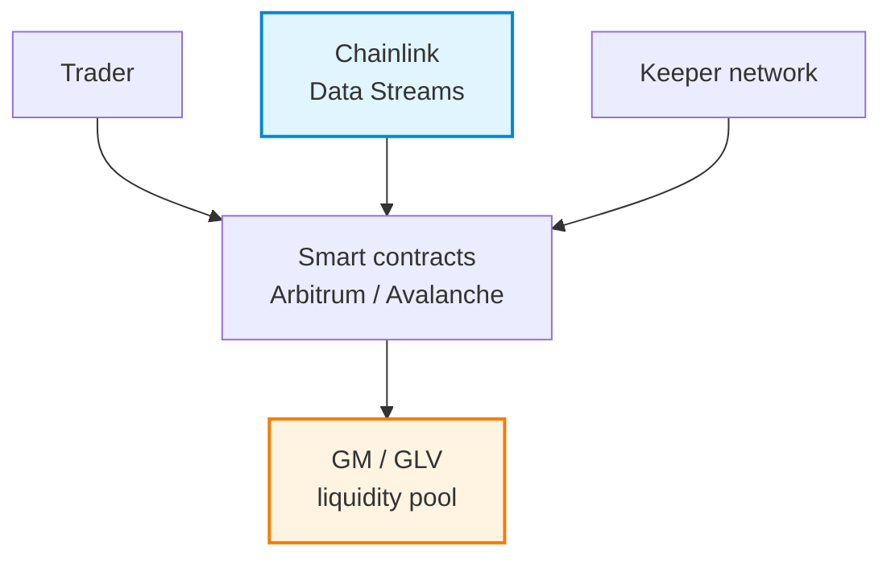
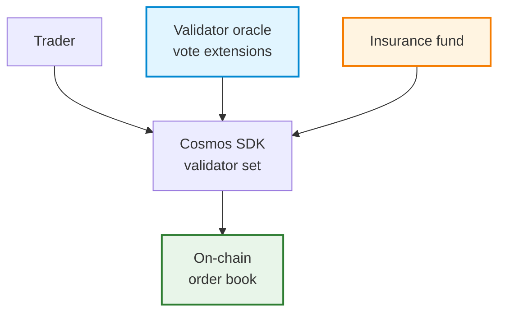
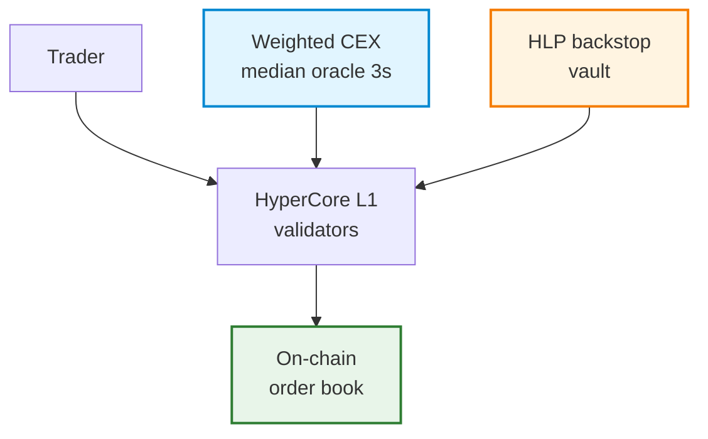
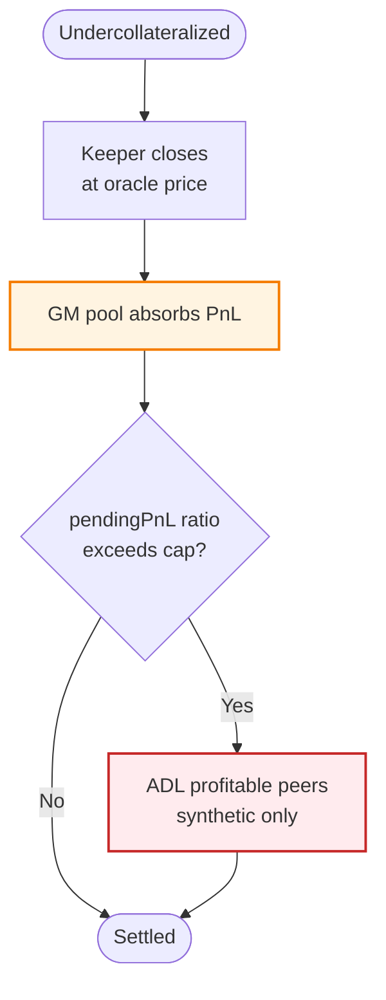
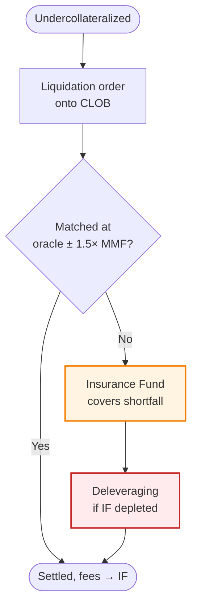
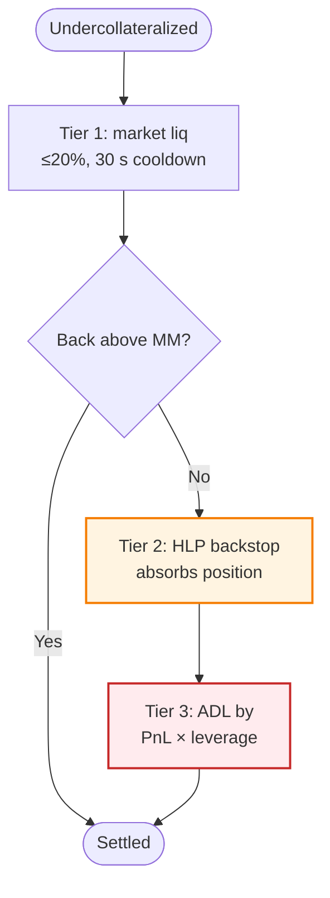
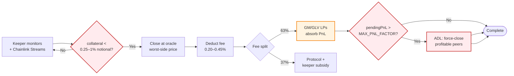

NTU · BITCOIN & CRYPTOCURRENCY · SPRING 2026

# Liquidation Mechanisms in Perp DEXes

  GMX
  &nbsp;·&nbsp;
  dYdX v4
  &nbsp;·&nbsp;
  Hyperliquid

A comparative study of design, safety, and the UX trade-off

  <b>黃泓諺</b> &nbsp;Hong-Yan Huang &nbsp;·&nbsp; R14922156

Topic J · May 2026

---

# Why this matters

Perp DEXes settle **tens of billions** in daily notional. The liquidation engine decides:

- Who pays for losing trades
- How fast bad debt is closed
- **Who eats the loss when markets gap**

  
🚀

  
UX

  
high leverage, low fees, partial liquidations

  
🛡️

  
Safety

  
conservative MM, deep insurance, fast oracles

  
🌐

  
Decentralization

  
permissionless keepers, no admin pause

<v-click>

  No platform wins all three. This talk maps the trade-offs.

</v-click>

---

# Vocabulary in 30 seconds

| Term             | What it means                                                        |
| ---------------- | -------------------------------------------------------------------- |
| **Mark price**   | Price used for PnL & liquidation checks (≠ last trade)               |
| **IM / MM**      | Initial / Maintenance margin                                         |
| **Liquidator**   | Actor that submits the closing tx for a reward                       |
| **Insurance fund** | Pooled capital that absorbs shortfalls                             |
| **ADL**          | Auto-deleveraging — force-close profitable positions to clear bad debt |

---
layout: section
---

# Part 1
## The Architectural Landscape

---
class: diagram-slide
---

# Three architectures, three philosophies

🟠 GMX v2 · Pool-counterparty

🟣 dYdX v4 · App-chain CLOB

🟢 Hyperliquid · CLOB + Vault

---

# Architecture cheat-sheet

|              | GMX v2     | dYdX v4      | Hyperliquid   |
| ------------ | ---------------------------- | -------------------------------- | --------------------------------- |
| Venue        | Arbitrum / Avalanche L2      | Cosmos SDK app-chain             | HyperCore L1                      |
| Matching     | **No book** — AMM vs pool    | On-chain CLOB                    | On-chain CLOB + HLP vault         |
| Counterparty | GM / GLV LPs                 | Other side + insurance fund      | Other side + HLP                  |
| Oracle       | Chainlink Data Streams       | Validator vote-extensions        | Weighted CEX median, 3 s          |
| Liquidator   | Permissionless keeper bots   | Liquidation daemon (any node)    | Anyone (market) + HLP (backstop)  |

---

# Leverage and margin

|                | GMX | dYdX v4    | Hyperliquid  |
| -------------- | --------------- | -------------------- | ------------------------------------ |
| Max leverage   | up to 100×      | 1–50× (tier-based)   | 3–40× (asset-tiered)                 |
| Modes          | Pool collateral | Cross + isolated     | Cross + isolated                     |
| MM rule        | 0.25–1 % floor  | Fixed MMF per market | $\text{MMR} = \text{IMR}/2$, by tier |

<v-click>

🔍 <b>Tier deep-cut (HL):</b> BTC 40× → drops to 20× above $150M OI per account. 
Aggressive UX, but structural defense against whale cascades.

</v-click>

---
layout: section
---

# Part 2
## The Liquidation Waterfalls

---
class: diagram-slide
---

# Liquidation waterfall — side by side

GMX

dYdX v4

Hyperliquid

👁️ <b>Hyperliquid's red path:</b> Tier 1 Market Liq → 30 s cooldown → Tier 2 HLP backstop → Tier 3 ADL

---

# Liquidation price formulas

GMX

Close at oracle adverse side:

- longs fill at `maxPrice`
- shorts fill at `minPrice`

Fee: <b>0.20 %</b> standard / 0.45 % synthetic

dYdX v4

Fillable price spread from oracle (sign $s$):

$$P_{\text{fill}} = P\bigl(1 - s\cdot\text{SMMR}\cdot\text{MMF}\cdot\text{BA}\cdot(1-Q)\bigr)$$

$s=+1$ long-liq · $s=-1$ short-liq

Penalty up to <b>1.5 %</b> of account value → IF

Hyperliquid

On-chain liq price:

$$P_{\text{liq}} = P_{\text{mark}} - s\,\frac{m_{\text{avail}}}{|S|}\,\frac{1}{1 - l/l_{MM}}$$

No fee; MM buffer forfeited if HLP takes the position

---

# Oracles: the trust delegation

| Property      | GMX            | dYdX v4     | Hyperliquid           |
| ------------- | ------------------------- | --------------------- | ---------------------------- |
| Source        | Chainlink Data Streams    | Validator side-cars   | Weighted CEX median          |
| CEX list      | Provider-internal         | 7+ exchanges          | Binance 3×, OKX 2×, …        |
| Cadence       | Sub-second (pull)         | ~1 s (per block)      | **3 s**                      |
| Aggregation   | Provider-internal         | Validator vote weight | Stake-weighted median        |
| Defense       | Two-phase commit          | Governance + quorum   | OI cap + 1 % resting-order cap |

<v-click>

📌 Common theme: <b>avoid thin internal AMMs as oracle</b>. Lesson learned from 2021–2022 spot-AMM exploits.

</v-click>

---

# Extreme-volatility defenses

|                  | GMX           | dYdX v4          | Hyperliquid            |
| ---------------- | -------------------------------------------- | ---------------------- | ---------------------------------------- |
| Circuit breakers | Price-impact 0.5–10 %                        | None explicit          | OI caps + 1 % resting-order cap          |
| Delay auction    | 2-phase commit (~1 block)                    | None                   | 3-s oracle + 30-s liq cooldown            |
| Backstop         | GM pool (`MAX_PNL_FACTOR`)                   | Insurance fund         | HLP vault                                 |
| ADL              | Synthetic markets only                       | After IF exhausted     | After HLP exhausted                       |

---

# Funding rate at a glance

|              | GMX            | dYdX v4                    | Hyperliquid           |
| ------------ | ------------------------- | ---------------------------------- | ---------------------------- |
| Type         | Adaptive (OI imbalance)   | Premium + interest                 | Premium + interest           |
| Sample       | per-second continuous     | 1 min                              | **5 s**                      |
| Settle       | on position touch         | hourly                             | hourly (1/8 of 8h rate)      |
| Cap          | 15–300 % APR              | $600\% \cdot (\text{IMF}-\text{MMF})$/8h | 4 % per hour            |

---
layout: section
---

# Part 3
## GMX Deep-Dive

The liquidation flow that backs $1B+ in TVL

---
class: diagram-slide
---

# GMX v2 liquidation flow

🔍 <b>Spotlight:</b> &nbsp; Keeper monitors &nbsp;→&nbsp; commit oracle (block N) &nbsp;→&nbsp; execute (block N+1) &nbsp;→&nbsp; <b>63%</b> fee → GM LPs / <b>37%</b> → protocol &nbsp;→&nbsp; ADL guard

---

# Worked example — $1M long ETH @ 10×

**Setup**
- Entry: **$3,000**
- Drop to: **$2,730** (−9 %)
- PnL: **−$90,000**
- Collateral left ≈ $10,000 *(below 1 % floor)*

**Liquidation**
- Keeper triggers liquidation
- Fee: 0.20 % × $1M = **$2,000**
  - $1,260 → GM pool LPs (63 %)
  - $740 → protocol (37 %)
- Pool absorbs: **+$90,000** PnL (in WETH)
- Residual to trader: ≈ **$8,000**

💡 GM pool ≈ short-vol, long-fee

Profits on liquidations; loses on sustained directional moves
(capped by <code>MAX_PNL_FACTOR</code> → ADL).

---

# GMX v1 → v2 evolution

| Aspect       | GLP v1 | GM / GLV v2 |
| ------------ | --------------------- | -------------------------------------- |
| Pool         | Single shared basket  | Per-market isolated pairs              |
| Risk         | One pool, all assets  | Contagion contained per market         |
| Oracle       | Chainlink push feeds  | Chainlink **Data Streams** (signed pull) |
| ADL          | Limited               | `MAX_PNL_FACTOR_FOR_ADL` per market    |

<b>Lesson behind the upgrade:</b> Sep 2022 AVAX manipulation on v1 GLP.

---
layout: section
---

# Part 4
## Lessons from the Battlefield

---

# Real incidents → real design changes

| Date         | Incident                  | Mechanism that failed         | Modern fix                             |
| ------------ | ------------------------- | ----------------------------- | -------------------------------------- |
| Mar 2020     | "Black Thursday"          | Maker 0-bid liquidations      | Backstop bidders, min bid floors       |
| May 2022     | LUNA / UST                | Reflexive collateral spiral   | OI / asset caps                        |
| Sep 2022     | GMX v1 AVAX               | Thin spot + single pool       | Per-market isolation                   |
| Nov 2022     | FTX collapse              | Centralized custody           | Validated non-custodial perp DEX thesis |
| **Mar 2025** | **Hyperliquid JELLY**     | HLP took toxic inventory      | Asset onboarding + per-asset risk budgets |

---

# JELLY squeeze — the modern case

**What happened**

- Attacker self-traded a low-cap asset into liquidatable state
- HLP backstop absorbed the position *(as designed)*
- Underlying spot too illiquid for HLP to unwind
- HLP took a multi-million $ loss

**What it teaches**

Insurance-fund primitives need:
- Asset onboarding due diligence
- Per-asset risk budgets
- Governance kill-switch

> *"Automated backstop" isn't automatic enough for adversarial new listings.*

---

# JELLY — quantitative attack model

**Microstructure inequality** *(necessary condition)*

$$\begin{cases} l \cdot c \;>\; L_{\text{exit}} & \text{book can't absorb} \\[2pt] l \cdot c \;\lesssim\; V & \text{HLP rich enough to swallow} \end{cases}$$

- For **BTC**: $L_{\text{exit}} \gg V$ → attack impossible
- For a **new listing**: inequality flips → HLP becomes the dump

**Expected extraction** *(dual-account model)*

$$\mathbb{E}[\text{extraction}] \approx \min\!\Bigl(N\tfrac{p_1-p_0}{p_0},\,V\Bigr) - c$$

Plugging JELLY numbers
($N \approx \$70$M, $4\times$ ramp, $V \approx \$240$M, $c \approx \$3.5$M):

$$\approx \min(\$210\text{M},\,\$240\text{M}) - \$3.5\text{M} \approx \boxed{\$206\text{M}}$$

Profit-side addresses exit clean USDC <i>before</i> HLP can unwind — the liquidity time-lag is the rent.

---
layout: section
---

# Part 5
## Open Problems & The Road Ahead

---

# Open risks (common to all three)

1. <b>Oracle compromise</b> — Chainlink integrity vs validator collusion

2. <b>MEV / front-running</b> of liquidations — reduced but not eliminated

3. <b>ADL fairness</b> — being force-closed in profit is brutal UX

4. <b>Chain halt</b> — sovereign chains pause trading <i>and</i> liquidation

5. <b>LP / HLP impermanent risk</b> — short-vol decays in trends

6. <b>Stablecoin / bridge risk</b> — USDC depeg affects all three

7. <b>Cross-margin correlation</b> — MM ignores off-diagonal $\rho_{ij}$

8. <b>Funding-induced cascade</b> — capped funding drains margin even on flat mark

---

# Cross-margin: the hidden correlation tax

**Today's maintenance check** *(diagonal only)*:

$$\mathrm{MM}_{\text{req}} = \sum_i |S_i|\,P_i\,\mathrm{MMF}_i$$

**But equity variance is** $n\!\times\!n$:

$$\mathrm{Var}(E) = \sum_{i,j} S_iS_j\,\sigma_i\sigma_j\,\rho_{ij}$$

In crashes $\rho_{ij}: 0.5 \to >0.9$ — ten alt-coin longs $\ne$ ten independent risks.

**Why no on-chain fix yet?** Cost.

| Approach | Per-account cost |
|---|---|
| Full SPAN matrix $H$ | $O(n^2)$ / block |
| Validator amortised  | $O(n^3)$ |
| <b>Correlation-group haircut</b> | <b>$O(n+K)$</b> |

FTX / CME-SPAN-style: bucket assets into $K \ll n$ classes, assume $\rho=1$ inside, step-wise add-on on dominant net exposure.

---

# Where the design space is going

Each idea pays a system-engineering price (in red).

🔐 <b>ZK-proven oracles</b> (Pyth Lazer, zkTLS) &nbsp;· cost: 200 ms–2 s prover latency → increases effective oracle staleness on 3 s-cadence chains

🏛 <b>Intent-based liquidation auctions</b> → MEV value back to user &nbsp;· cost: window $\tau$ → bad debt $\Delta D \sim |S|\,v\,\tau$; linear in crashes

🤝 <b>Hybrid CLOB + RFQ</b> for liquidated inventory &nbsp;· cost: RFQ round-trip + mandatory CLOB fallback path = 2× engineering surface

🧱 <b>Per-asset insurance tranches</b> — no monolithic HLP &nbsp;· cost: fragmented capital → thin-asset vaults demand higher yields

✅ <b>Formal verification</b> of margin invariants &nbsp;· cost: protocol upgrades require re-proving; months per change

⚡ <b>Programmable circuit breakers</b> — per-asset LULD-style bands &nbsp;· cost: false-positive freezes legitimate hedging; vol-detector becomes governance risk

---
layout: center
class: text-center
---

# Three answers to one question

  
GMX

  
Isolate risk on willing LPs, trust Chainlink.

  
dYdX v4

  
Rebuild CEX inside a sovereign chain, transparent IF.

  
Hyperliquid

  
Aggressive leverage backed by a community vault.

None dominates. The next generation will <b>mix primitives</b> — oracles from one, insurance from another, matching from a third — to <i>break</i> rather than <i>navigate</i> the UX-vs-safety trade-off.

Questions?

---
layout: end
---

# Thank you

Report · Slides · Script — all in the project repo

Citation map: [refs.md](../refs.md)
